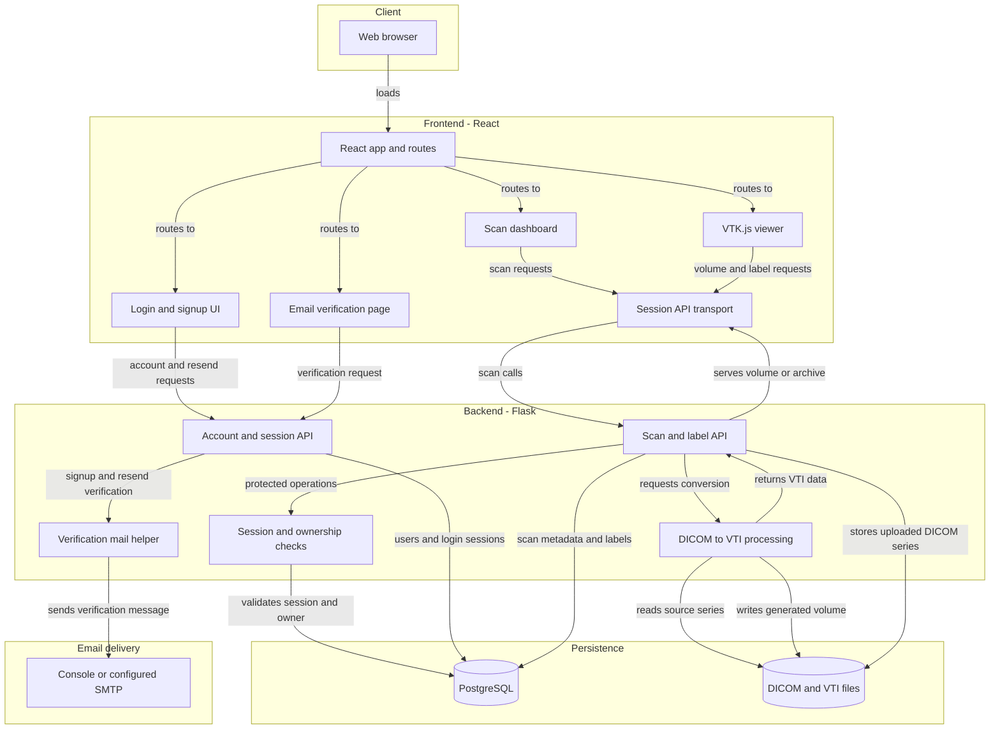
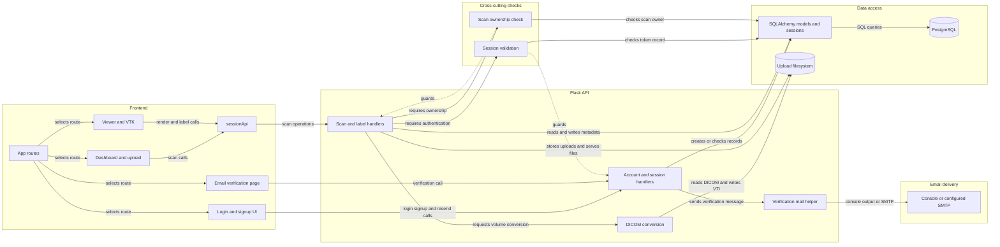

# Architecture Diagram

These diagrams describe the checked-in application structure and runtime data paths. They focus on the scan upload and viewing workflow, its persistence boundaries, and the API components that protect user-owned scans.

## Application Architecture

<!-- mermaid-checked: no \n, no em-dash/en-dash, no {} in labels, subgraphs are id["label"], arrows are -->|"label"|, all subgraphs closed by end, ids unique -->

### Technology Stack Summary

| Layer | Technology | Version | Purpose |
|---|---|---|---|
| Browser UI | React | 18.2.0 | Account, scan, and verification workflows |
| 3D visualization | VTK.js | 36.12.0 | Renders VTI volumes with WebGL |
| Frontend runtime | Node.js | 18 in Docker | Runs the React development server |
| API | Flask | 3.1.3 | Account, scan, label, and rendering endpoints |
| Image processing | pydicom, VTK, NumPy | 2.4.5, 9.6.2, 2.5.2 | Reads DICOM series and creates VTI volumes |
| Data access | SQLAlchemy | 2.0.52 | Maps and queries application records |
| Relational database | PostgreSQL | 14 in Compose | Stores users, sessions, scans, and labels |
| Container orchestration | Docker Compose | 3.8 file format | Starts frontend, backend, and database services |

### Data Storage & External Services

PostgreSQL stores user, login-session, DICOM-upload, and label records. The backend stores uploaded DICOM files and generated `volume.vti` files under `backend/uploads`; Compose bind-mounts this directory but does not define a persistent database volume. The backend reads database connection settings from `database.ini`. Signup and resend-verification routes use a mail helper; console output is the default, while SMTP is configurable through environment settings. Email delivery is separate from the scan-viewing path.

### Key Architectural Decisions

- A single Flask API serves account/session operations, scan metadata, labels, file downloads, and volume conversion to the React client.
- Scan metadata is relational, while medical-image data and generated VTI volumes are filesystem assets. Backups and deployments must account for both.
- Protected scan operations validate a database-backed session and verify scan ownership before accessing files or labels.
- Accounts must verify their email before login; signup and resend requests deliver verification messages through console or configured SMTP.

## Component Relationships

<!-- mermaid-checked: no \n, no em-dash/en-dash, no {} in labels, subgraphs are id["label"], arrows are -->|"label"|, all subgraphs closed by end, ids unique -->

### Component Inventory

| Component | Layer | Type | Responsibility |
|---|---|---|---|
| `App.js` | Frontend | Router | Declares landing, login, verify, dashboard, and viewer routes; protects dashboard and viewer |
| `Login.js`, `LoginPage.js` | Frontend | Page and component | Provides login and signup UI; signup is toggled within `/login` |
| `SignUpPage.js` | Frontend | Component | Creates an account and reports verification-email status |
| `VerifyEmail.js` | Frontend | Page | Submits the email token from the `/verify` link |
| `Dashboard.js`, `UploadSection.js` | Frontend | Page and component | Lists scans, uploads DICOM files, and opens or downloads scans |
| `Viewer.js`, `VTKViewer.js` | Frontend | Page and visualization | Requests a volume and displays it using VTK.js |
| `sessionApi.js` | Frontend | Transport helper | Stores session state, renews sessions, and sends authenticated requests |
| `app.py` account routes | API | Flask route handlers | Signup, verified login, email verification/resend, logout, and session renewal |
| `app.py` scan routes | API | Flask route handlers | Uploads, lists, renames, downloads, renders, and labels scans |
| `require_session` | Cross-cutting | Decorator | Validates the submitted login session for protected operations |
| `require_scan_owner` | Cross-cutting | Decorator | Confirms the authenticated user owns the requested scan |
| `session_tokens.py` | Backend | Session service | Creates, validates, renews, and revokes database-backed sessions |
| `db.py`, `models.py` | Data access | SQLAlchemy | Manages database connections and maps application entities |
| DICOM processing in `app.py` | Backend | Processing component | Reads DICOM series, constructs a volume, and writes VTI output |
| `backend/uploads` | Persistence | Filesystem storage | Holds uploaded DICOM files, generated VTI files, and download inputs |
| `mailer.py` | Backend | Mail service helper | Sends verification messages to console by default or through configured SMTP |
